 

  

 

###  &nbsp;hey, i'm samuel

CS student focused on **Software Engineering** and **Artificial Intelligence** — currently looking for a **SWE internship in São Paulo**.
I like building practical, scalable stuff and figuring out where AI and automation actually move the needle for a business.

 

### ⚡ stack

  

 

### 🛠️ stuff i built

<table>
<tr>
<td width="33%" valign="top">

**[🩺 triage-AI](https://github.com/nickezinho/triage-AI)**
 Medical triage powered by AI + Google Maps to point patients to the right place.

</td>
<td width="33%" valign="top">

**[📈 company-goals](https://github.com/nickezinho/company-manager)**
 Track goals and data across your company in one place.

</td>
<td width="33%" valign="top">

**[💬 whatsapp-automation](https://github.com/nickezinho/whatsapp-hr-automation)**
 Automated WhatsApp messages for HR workflows.

</td>
</tr>
</table>

 

### 📊 numbers

  <!-- gerado pela action em .github/workflows/stats.yml -->
  

 

<!-- gerado pela action em .github/workflows/snake.yml -->
<picture>
  <source media="(prefers-color-scheme: dark)" srcset="https://raw.githubusercontent.com/nickezinho/nickezinho/output/snake-dark.svg" />
  
</picture>

<i>"everything in its right place"</i> 🔛🔝 &nbsp;·&nbsp; HxH is peak fiction &nbsp;·&nbsp; 🏀

